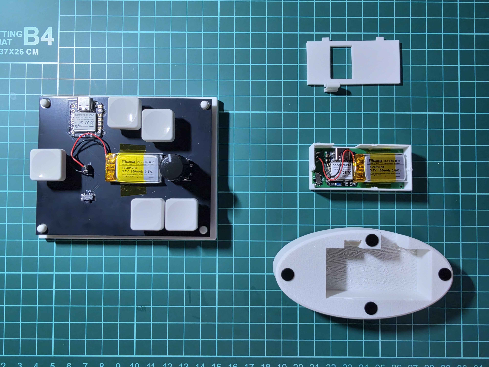
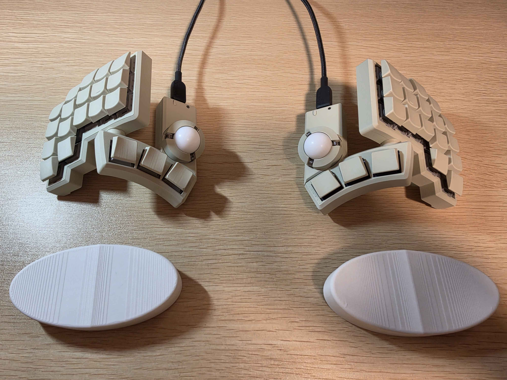

# roost

[](https://github.com/iid1/roost/actions/workflows/build.yml)
[](LICENSE)

[Japanese README is available here](./README_ja.md)

# Overview
roost is a system designed to make a wrist-rest-integrated mouse (referred to as a "wrist mouse") practical and functional.
The wrist mouse itself is named **perch**, which serves as the core product of this repository and the origin of the entire concept.
Due to its form factor as a wrist rest, buttons cannot be practically integrated into perch, meaning a separate companion device is necessary for click and navigation operations.
The overarching ecosystem encompassing these complementary devices is named **roost**.


*(Left: sub_feeder, Right: disassembled perch)*

This repository is published in the hope of supporting and inspiring the DIY and maker activities of anyone intrigued by the concept of wrist-worn / wrist-rest pointing devices.
While provided under an open hardware license, use and modification are freely encouraged.
Please note that I am a hobbyist and not a professional in circuit design, so please feel free to improve, refine, and adapt the designs.
Issues and Pull Requests are warmly welcome!

### Acknowledgments
- In developing this hardware, the optical sensor and power circuitry are modified from the open-source hardware [**BOB-PMW3360-SUMI**](https://github.com/snize/BOB-PMW3360-SUMI) (Reference product: [PMW3360 Breakout Board SUMI](https://bulblub.booth.pm/items/6164153)) created by **Tomotsugu Kaneko ([@snize](https://github.com/snize))**. I express my sincere gratitude for making this design openly available on GitHub.
- This documentation also references and includes photos featuring [**KobitoKey (小人キー)**](https://iikagen-11.booth.pm/items/7511676) by **[@juichi50iii](https://github.com/juichi50iii)**.

---

## System Structure & Table of Contents

### Ecosystem Devices
- [**perch**](#perch): Wrist-rest optical mouse (PixArt PMW3360 + Seeed Studio XIAO BLE)
  - [Features](#features) / [Philosophy](#philosophy)
- [**sub_feeder**](#sub_feeder): Left-hand companion controller with 5 keyswitches & EC11 rotary encoder
  - [Philosophy](#philosophy-1)
- *(Upcoming)* **feeder**: Ergonomic keyboard designed specifically to complement perch

### Table of Contents
- [Overview](#overview)
- [perch](#perch)
  - [Features](#features)
  - [Philosophy](#philosophy)
- [sub_feeder](#sub_feeder)
  - [Philosophy](#philosophy-1)
- [Design & Operational Philosophy](#design--operational-philosophy)
  - [Challenges of Wrist Mice](#challenges-of-wrist-mice)
  - [How roost Solves It (perch + sub_feeder)](#how-roost-solves-it-perch--sub_feeder)
- [Directory Structure](#directory-structure)
- [Hardware Specifications & JLCPCB Manufacturing Guide](#hardware-specifications--jlcpcb-manufacturing-guide)
  - [1. perch (Wrist-Rest Mouse)](#1-perch-wrist-rest-mouse)
  - [2. sub_feeder (Left-Hand Controller)](#2-sub_feeder-left-hand-controller)
- [sub_feeder Layer Mapping](#sub_feeder-layer-mapping)
- [Automated Firmware Builds via GitHub Actions](#automated-firmware-builds-via-github-actions)
- [Flashing the Firmware](#flashing-the-firmware)
- [Notes & Tips](#notes--tips)
- [Licenses & Attribution](#licenses--attribution)
- [Changelog](#changelog)

---

# perch
A dedicated device for navigating the mouse cursor.
It is the main product of this repository.

## Features
- Operated with your wrist or the base of your palm resting naturally on top.
- Because it has no built-in click mechanism, its vertical depth is very slim, allowing it to sit right in front of your keyboard.

## Philosophy
The features above are essentially those of a conventional wrist rest (palm rest), with pointing functionality added directly into it.
This device was created to eliminate physical strain on the wrist.
While I feel it is not yet fully refined as both creator and daily user, I believe the fundamental direction of the concept is promising.

In my daily setup, I normally use a non-slip wrist rest for the keyboard and a sliding wrist rest for the mouse (as well as for trackballs).
I previously used a Keyball keyboard, but found that operating a trackball requires delicate thumb maneuvers, which surprisingly caused fatigue and strain on the wrist.
Consequently, I returned to using a dedicated pointing device, but the common dilemma often cited when transitioning to trackball keyboards remained: *"With a standard keyboard and mouse, you have to lift and move your hand away from the keyboard whenever you need to use the mouse."*

Reflecting on this hand movement, I came to believe that the primary cause of wrist strain is the subtle lifting motion required when switching your grip onto a rounded, conventional mouse.
To eliminate this, the idea was born: *Why not add mouse functionality directly to the wrist rest that my hand is already resting on?*

The name **perch** refers to a bird's resting place / branch (止まり木).
It was named in the hope that users can operate the pointer effortlessly while resting their hands.
(Initially, I considered naming the wrist mouse *tomariGi* and the keyboard *naSashi* [菜差し, a Japanese feeder tool used to offer greens to caged birds]. However, between a perch and a green-holder, the perch is physically larger, which inverted the actual size ratio between the wrist mouse and the keyboard in this repository. Therefore, the keyboard was designated as *feeder* [餌台]. Viewing your hands as little birds pecking at the keyboard also felt fitting and charming.)


# sub_feeder
A companion device responsible for mouse clicks, wheel scrolling, and side buttons.
When perch is used with the right hand, sub_feeder is placed on the left side.
Because a wrist mouse is not grasped between your fingers, it naturally moves slightly while typing.
Furthermore, unlike a standard mouse, you cannot simply lift it slightly off the desk to reposition your hand in the air during long-distance cursor traversal without moving the pointer.
To address this, sub_feeder incorporates toggle and hold keys to dynamically enable and disable pointing output.

## Philosophy
sub_feeder is an interim stepping stone until a dedicated keyboard (*feeder*) optimized for perch is created.
To be frank, it has its inconveniences: while right-hand travel is minimized, left-hand travel increases to reach this companion device.
If you already have a ZMK-compatible programmable keyboard, assigning mouse clicks to keys on that keyboard is much more recommended. (Since feeder is not yet complete, I personally use perch paired with **KobitoKey** by [@juichi50iii](https://github.com/juichi50iii) available on [BOOTH](https://iikagen-11.booth.pm/items/7511676), running custom ZMK firmware from [KobitoKey_QWERTY_iid1](https://github.com/iid1/KobitoKey_QWERTY_iid1). Honestly, the KobitoKey setup feels so comfortable that the completion of feeder is somewhat in jeopardy—having both a trackball and perch side-by-side works surprisingly well).
Because trackball-equipped keyboards already integrate mouse actions into key bindings, pairing perch with an existing split keyboard delivers a very similar, unified experience.


*(Top: KobitoKey, Bottom: perch)*

---

## Design & Operational Philosophy

### Challenges of Wrist Mice
A wrist mouse placed directly in front of the keyboard minimizes hand movement, but conventional implementations suffer from a critical flaw: **the sensor detects subtle wrist shifts during typing, causing unintended cursor drifting**.

### How roost Solves It (perch + sub_feeder)
In roost, we leverage ZMK Firmware's `input-processor` engine to adopt the philosophy of **"activating the pointer only when needed"** and **"instantly converting wrist movement into scrolling"**:

1. **Pointer Inactive by Default (Zero Drift)**
   - In Layer 0 (default), pointer delta scaling is set to **0x (disabled)**. No matter how much your wrists shift during typing, the cursor remains completely locked in place.
2. **Intuitive Mouse Activation (Hold & Toggle)**
   - **Momentary Hold**: Holding `SW4` on sub_feeder immediately activates cursor movement (1x scale) for quick pointing gestures.
   - **Continuous Navigation**: Tapping `SW6` toggles Mouse Mode ON (Layer 2). You can point naturally with perch on your right wrist while executing Left Click (`SW2`) and Right Click (`SW3`) with your left hand.
3. **Wrist-Driven Smooth Scrolling**
   - Holding `SW6` for >500ms transitions into Scroll Mode (Layer 3).
   - Wrist movements on perch are dynamically converted into smooth 2-axis scrolling (with Y-axis inversion and fine 1/8 scaling).
4. **Zooming & Multi-Host Switching**
   - Rotating the EC11 rotary encoder zooms in/out (`Ctrl + +` / `Ctrl + -`).
   - Long-pressing the encoder push switch switches to Layer 1 for Bluetooth host switching (up to 3 paired computers), mute, and volume adjustments.

---

## Directory Structure

```text
roost/
|-- .github/
|   `-- workflows/
|       `-- build.yml               # GitHub Actions automated firmware build workflow
|-- build.yaml                      # ZMK build matrix (perch / sub_feeder)
|-- config/
|   |-- west.yml                    # PMW3360 optical sensor driver manifest
|   `-- boards/shields/             # ZMK shield definitions
|-- perch/                          # [Wrist-Rest Optical Mouse] (formerly wrist_mouse)
|   |-- circuit/                    # Schematics, PCB layout & JLCPCB manufacturing files
|   |   |-- kicad/                  # KiCad design files (.kicad_sch, .kicad_pcb)
|   |   |-- gerber/                 # JLCPCB Gerber production zip
|   |   `-- jlcpcb_smt/             # JLCPCB SMT assembly BOM & CPL CSV files
|   |-- 3dModel/                    # 3D enclosure CAD models
|   |   |-- stl/                    # STL files for 3D printing
|   |   `-- step/                   # STEP & 3MF assembly models
|   `-- firmware/                   # ZMK firmware
|       |-- prebuilt/               # Ready-to-flash .uf2 firmware binaries
|       `-- shield/                 # ZMK shield configuration & overlay
|-- sub_feeder/                     # [Left Macro Controller] (formerly left_device)
|   |-- circuit/                    # Schematics & PCB layout
|   |   |-- kicad/                  # KiCad design files (.kicad_sch, .kicad_pcb, .dxf)
|   |   |-- gerber/                 # JLCPCB Gerber production zip
|   |   `-- README.md               # Component Bill of Materials (BOM)
|   |-- 3dModel/                    # 3D enclosure CAD models
|   |   `-- step/                   # STEP & F3D CAD models
|   `-- firmware/                   # ZMK firmware
|       |-- prebuilt/               # Ready-to-flash .uf2 firmware binaries
|       `-- shield/                 # ZMK keymap & overlay definitions
|-- README.md                       # English documentation (this file)
|-- README_ja.md                    # Japanese documentation
|-- LICENSE                         # CERN-OHL-P v2 License
`-- .gitignore
```

---

## Hardware Specifications & JLCPCB Manufacturing Guide

### 1. perch (Wrist-Rest Mouse)
- **Microcontroller**: Seeed Studio XIAO BLE nRF52840 (`seeeduino_xiao_ble`)
- **Optical Sensor**: PixArt PMW3360 (`PMW3360DM-T2QU`) with dedicated lens
- **LDO**: TLV70019 (1.9V output)
- **JLCPCB Order Process**:
  1. Upload `perch/circuit/gerber/wrist_mouse.zip` to the JLCPCB PCB order page.
  2. Select 2-layer, **1.6mm thickness** (recommended) or 1.2mm.
  3. Turn ON **PCB Assembly (SMT)** and select files from `perch/circuit/jlcpcb_smt/`:
     - **BOM**: `wrist_mouse_bom.csv`
     - **CPL**: `wrist_mouse_cpl.csv`
  4. SMT assembly automatically mounts chip capacitors, resistors, and the 1.9V LDO regulator.
  5. Hand-solder parts: PMW3360 sensor IC, Seeed Studio XIAO BLE, and 3.7V LiPo battery.

### 2. sub_feeder (Left-Hand Controller)
- **Microcontroller**: Seeed Studio XIAO BLE nRF52840
- **Switches**: Kailh Choc V1 / V2 low-profile switches x5 (hotswap sockets supported)
- **Encoder**: EC11-compatible rotary encoder with push button x1
- **JLCPCB Order Process**:
  1. Upload `sub_feeder/circuit/gerber/left_device.zip` to JLCPCB.
  2. Specifications: 2-layer, 1.6mm thickness, solder mask color of choice (black, white, green, etc.).
  3. Hand-solder parts: Kailh Choc sockets x5, EC11 rotary encoder x1, XIAO BLE x1, and battery connector.

---

## sub_feeder Layer Mapping

| Layer | SW2 (D0) | SW3 (D1) | SW4 (D2) | SW5 (D3) | SW6 (D4) | SW1 (ENC_SW) | Encoder Rotation |
| :--- | :--- | :--- | :--- | :--- | :--- | :--- | :--- |
| **0: Default** | Left Click | Right Click | Japanese (Hold: Mouse ON) | English (LANG2) | Tap: Mouse Toggle<br>Hold 0.5s: Scroll | Hold: Layer 1 | Zoom In/Out (`Ctrl +-`) |
| **1: BT / Media** | Clear BLE Profile | Host 1 (BT 0) | Host 2 (BT 1) | Host 3 (BT 2) | Mute | (Held) | Volume Up / Down |
| **2: Mouse ON** | Left Click | Right Click | Japanese (Hold: Keep ON) | English | Tap: Mouse OFF<br>Hold 0.5s: Scroll | Layer 1 | Zoom In/Out (`Ctrl +-`) |
| **3: Scroll Mode** | Left Click | Right Click | Middle Click (`MCLK`) | Browser Back (`MB4`) | (Held) | Layer 1 | Zoom In/Out (`Ctrl +-`) |

- **Combos**:
  - `SW6 + SW5`: Browser Back (`MB4`)
  - `SW6 + SW4`: Middle Click (`MCLK`)

---

## Automated Firmware Builds via GitHub Actions

This repository is configured out of the box to compile firmware in the cloud:

1. Create a repository on GitHub (e.g. `roost`).
2. Push this folder:
   ```bash
   git init
   git add .
   git commit -m "feat: initial commit of roost"
   git branch -M main
   git remote add origin https://github.com/iid1/roost.git
   git push -u origin main
   ```
3. Visit the **Actions** tab on your GitHub repository. The build will run automatically in 2-3 minutes.
4. Download the `firmware.zip` artifact containing the compiled `.uf2` files.

---

## Flashing the Firmware

1. Connect Seeed Studio XIAO BLE to your computer via USB-C.
2. Quickly double-press the physical **Reset button** on the XIAO board.
3. A mass storage device (`XIAO-SENSE` or `XIAO-nRF`) will appear on your desktop.
4. Drag and drop the corresponding `.uf2` file:
   - For sub_feeder: `left_device-xiao_ble__zmk-zmk.uf2` (shield name: `left_device`)
   - For perch: `wrist_mouse-xiao_ble__zmk-zmk.uf2` (shield name: `wrist_mouse`)
5. The device will automatically reboot with the new firmware.

*(Note: If BLE pairing fails or needs a clean reset, flash `settings_reset-xiao_ble__zmk-zmk.uf2` once to both devices).*

---

## Notes & Tips
I apply mouse skates (dots/feet) to the bottom of perch for smooth gliding.
I personally use [WALLHACK Skates Dots](https://wallhack.com/products/skates-dots) (they provide great glide, although they are a bit pricey).

---

## Licenses & Attribution

### License
This project (including both original and modified hardware designs, circuits, 3D models, and documentation) is licensed under the **[CERN Open Hardware Licence Version 2 - Permissive (CERN-OHL-P v2)](LICENSE)**.

### Hardware Attribution & Derived Circuitry (BOB-PMW3360-SUMI)
The optical sensor interface and 1.9V power supply circuitry of **perch** are modified from and based on the open-source hardware project [**BOB-PMW3360-SUMI**](https://github.com/snize/BOB-PMW3360-SUMI) (Reference: [PMW3360 Breakout Board SUMI](https://bulblub.booth.pm/items/6164153)) created by **Tomotsugu Kaneko ([@snize](https://github.com/snize))**, licensed under the **[CERN OHL-P v2](https://spdx.org/licenses/CERN-OHL-P-2.0.html)**.

#### Specific Parts in perch Derived from SUMI:
The following schematic components and footprint definitions in `perch/circuit/kicad/wrist_mouse.kicad_sch` originate from BOB-PMW3360-SUMI:

| Circuit Block | Component Reference | Part / Value | Function in SUMI Design |
| :--- | :--- | :--- | :--- |
| **Sensor circuitry** | `U3` | `PMW3360DM-T2QU` | PixArt PMW3360 optical sensor IC |
| **Sensor circuitry** | `C1`, `C4` | `0.1uF` | Decoupling capacitors for PMW3360 |
| **Sensor circuitry** | `R1`, `R3` | `10k` | Pull-up resistors for Reset / NCS |
| **Sensor circuitry** | `R2` | `39R` | LED current-limiting resistor (39 ohm) |
| **1.9V Power supply** | `U2` | `TLV70019DDCR` | 1.9V LDO regulator (SOT-23-5) powering PMW3360 |
| **1.9V Power supply** | `C2` | `1uF` | Input capacitor for TLV70019 |
| **1.9V Power supply** | `C3` | `4.7uF/10V` | Output capacitor for TLV70019 |
| **KiCad Library** | Symbol / Footprint | `sumi-symbols:PMW3360DM-T2QU`<br>`sumi-footprints:PMW3360DM-T2QU` | Symbol and footprint definitions by snize |

#### Modifications Made in perch:
1. **Integrated All-in-One Design**: While BOB-PMW3360-SUMI is a standalone breakout board connected via pin headers, perch directly integrates this sensor and 1.9V LDO circuitry onto a unified mainboard alongside Seeed Studio XIAO BLE nRF52840, LiPo battery management, and custom power switching.
2. **Custom PCB Form Factor**: PCB layout and trace routing were redesigned from scratch to fit the slim wrist-rest enclosure and position the optical sensor at the ideal ergonomic contact point.

---

## Changelog

| Version | Date | Description |
| :--- | :--- | :--- |
| **v1.0** | 2026-11-03 | Initial release of roost / perch / sub_feeder documentation |
