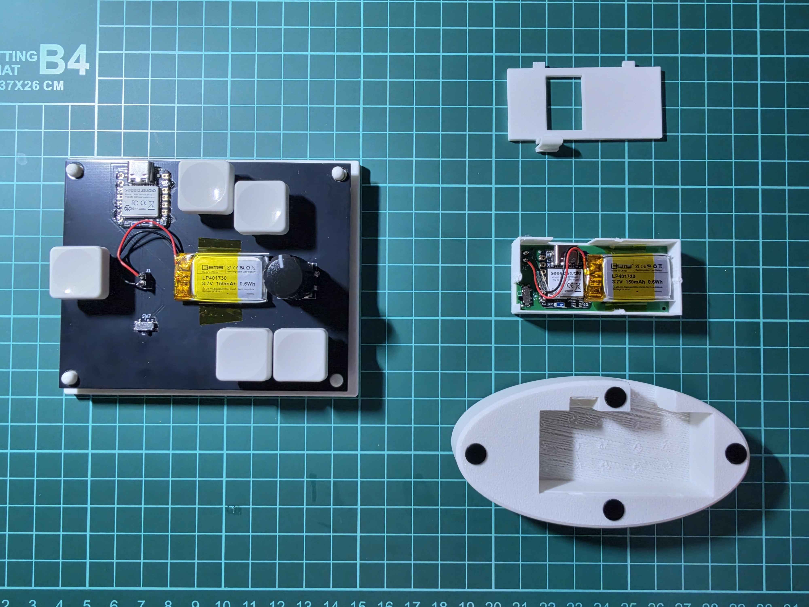
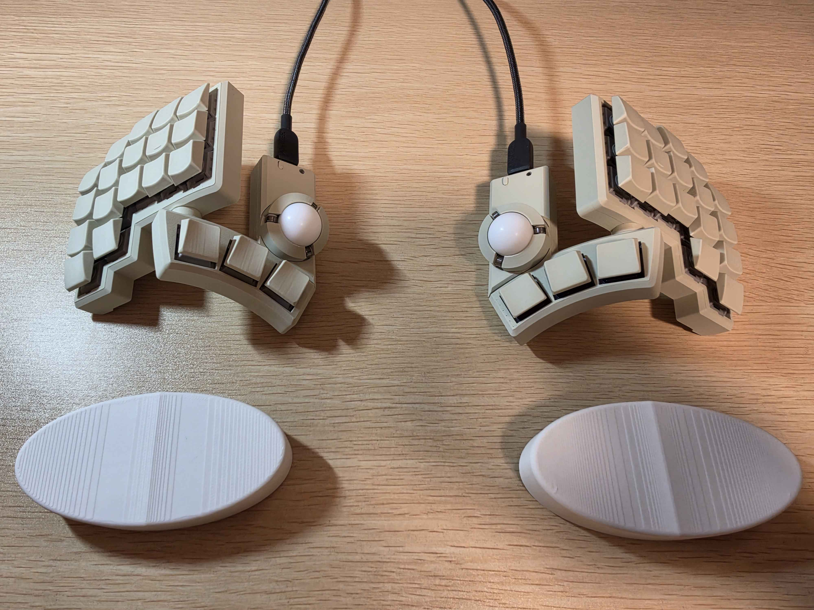

# roost (宿り木)

[](https://github.com/iid1/roost/actions/workflows/build.yml)
[](LICENSE)

[English README is available here](./README.md)

# 概要
roostはリストレストにマウスセンサーを搭載したマウス(以下wrist mouse)を機能させるためのシステムです。
perch(止まり木)と呼称しているものがwrist mouseであり、発想の原点になります。
wrist mouseはその性質上ボタンを組み込むことができないため、クリック操作のためのデバイスが別途必要になります。
このデバイスを内包した呼称をroost(宿り木)としています。


*左がsub_feeder、右がperchを分解したもの*

このレポジトリはwrist mouseの思想に興味を持っていただいた方々の制作活動の一助になればと考えて公開しています。
ライセンス付与もしていますが、使用、改変を許可します。
特に回路設計に関しては素人のため、改良して使用してください。
issue、pull requestに関しても上げていただければ確認いたします。

また、このデバイス開発において**Tomotsugu Kaneko ([@snize](https://github.com/snize))** 氏が作成された回路 ([**BOB-PMW3360-SUMI**](https://github.com/snize/BOB-PMW3360-SUMI)、参考product : [PMW3360 ブレイクアウトボード SUMI（墨）](https://bulblub.booth.pm/items/6164153))を改変して使用しています。githubでの情報公開に深く感謝申し上げます。

**いい加減([@juichi50iii](https://github.com/juichi50iii)**) 氏の[小人キー](https://iikagen-11.booth.pm/items/7511676) にも言及、写真掲載を行っています。

---

## システム構成 & 目次

### 構成デバイス
- [**perch (止まり木)**](#perch-止まり木): リストレスト型光学マウス（PixArt PMW3360 + Seeed Studio XIAO BLE）
  - [特徴](#特徴) / [思想](#思想)
- [**sub_feeder (仮餌台)**](#sub_feeder-仮餌台): 左手でクリック操作する5キースイッチ＆ロータリーエンコーダーコントローラー
  - [思想](#思想-1)
- *(今後追加予定)* **feeder (フィーダー)**: perchを前提としたkeyboad

### 目次
- [概要](#概要)
- [perch (止まり木)](#perch-止まり木)
  - [特徴](#特徴)
  - [思想](#思想)
- [sub_feeder (仮餌台)](#sub_feeder-仮餌台)
  - [思想](#思想-1)
- [システムの動作思想（Design & Operation Philosophy）](#システムの動作思想design--operation-philosophy)
  - [wrist mouseの課題](#wrist-mouseの課題)
  - [roost が解決したアプローチ (perch + sub_feeder)](#roost-が解決したアプローチ-perch--sub_feeder)
- [ディレクトリ構成](#ディレクトリ構成)
- [ハードウェア仕様・JLCPCB 発注ガイド](#ハードウェア仕様jlcpcb-発注ガイド)
  - [1. perch (リストレスト型マウス)](#1-perch-リストレスト型マウス)
  - [2. sub_feeder (左手コントローラー)](#2-sub_feeder-左手コントローラー)
- [キーマップ・レイヤー詳細 (sub_feeder)](#キーマップレイヤー詳細-sub_feeder)
- [GitHub Actions による自動ファームウェアビルド](#github-actions-による自動ファームウェアビルド)
- [ファームウェアの書き込み手順](#ファームウェアの書き込み手順)
- [補足](#補足)
- [ライセンス & 謝辞・著作権表示 (Licenses & Attribution)](#ライセンス--謝辞著作権表示-licenses--attribution)
- [更新履歴](#更新履歴)

---

# perch (止まり木)
マウスカーソルの位置を操作するデバイスです。
このrepositoryのmain productです。

## 特徴
- 手首や手の付け根を乗せて操作する
- クリック操作するための機構がないため縦幅が狭いためキーボードの手前に置くことができる

## 思想
上記の特徴はリストレスト(パームレスト)が持っているもので、これにポインティング機能を追加したものになります。
手首への負担を解消するためのデバイスとして制作しました。
まだ製作者兼使用者として洗練しきれていないと実感していますが、発想の方向性は良いのではないかと考えています。

私は普段キーボードには滑り止めがついているリストレスト、マウスには一緒に動くリストレスト(トラックボールマウスも同様)を使用しています。
以前KeyBallを使用していたこともありましたが、トラックボール操作は親指の繊細な動作が求められ、手首への負担が意外とあるという感想を抱きました。
そのためポインティング専用のデバイス使用に戻ったのですが、よくトラックボール付きのキーボードへの移行で言及される「通常のキーボードマウスだと、マウス操作の時にキーボードから手を移動する必要がある」の問題が残りました。
私はこの手の移動について、最も手首への負担になっているのが、丸い形状のマウスに持ち替えるときに生じる微妙な手の持ち上げではないかと考えています。
これを解消するために、既に使用していた手を置く機能のリストレストにマウス機能を追加しよう、というのがこのデバイスの発想です。

perchという名前は鳥が休憩をする「止まり木」を意味します。
手を休めながら動作を行うことができることを期待して名付けています。
(初めはwrist mouseをtomariGi、keyboardをnaSashi(菜差し、鳥かごなどで鳥に野菜を与えるときに使用する道具)にしようとしていたのですが、止まり木と菜差しでは止まり木の方が大きく、このrepositoryで提供するwrist mouseとkeyboardとのサイズ比と逆になってしまうため、keyboardはfeeder(餌台)としました。手を鳥に見立てるとkeyboardをつついている感じでかわいい(?))


# sub_feeder (仮餌台)
マウスのクリックやホイール操作、サイドボタンを担当するデバイスです。
perchを右手で使用する場合は左手側に置いて使用します。
wrist mouseはつまんで持たないため、タイピング中に動いてしまいます。
また、カーソルを長距離移動するときに行っている一旦マウスを浮かせてカーソルを動かさないようにして空中で移動させる、ということもできません。
この対策として、この左手デバイスにトグルやホールドでポインティングを適用するかどうかの切り替え操作も割り当てています。

## 思想
これはperchに最適化されたkeyboard(feeder)を作成するまでのつなぎです。
正直使いづらい、右手の移動は小さくなったのにこれのせいで左手の移動が増えます。
ZMK対応のキーボードがある場合はそちらにクリックなどを割り当てたほうがよいです(私はfeederが完成していないため、[@juichi50iii](https://github.com/juichi50iii) 氏の[小人キー](https://iikagen-11.booth.pm/items/7511676) にperchを認識させて使用しています。[使用しているfw](https://github.com/iid1/KobitoKey_QWERTY_iid1) : 正直小人キーの使い心地が良すぎてfeederの完成は危ぶまれています。トラックボールもperchも両方あって良い)。
トラックボール付きキーボードはキーボードにマウス機能を割り当てているので、それと同じような使用感になります。


*上が小人キー、下がperch*

---

## システムの動作思想（Design & Operation Philosophy）

### wrist mouseの課題
リストレストに光学センサーを装着する「wrist mouse」は、キーボードの手前に置くことで手の動きを抑えるデバイスですが、**「タイピング中にもセンサーが反応してカーソルが勝手に移動する」** という欠点があります。

### roost が解決したアプローチ (perch + sub_feeder)
roost では、ZMK Firmware の `input-processor` 機能を駆使し、**「必要な瞬間だけポインターを有効化する」「手首の移動をスクロールへと切り替える」** という動作を採用しました。

1. **常時停止**
   - 通常時（レイヤー0）は、手首をどれだけ動かしてもカーソル移動量は **0倍（無効化）** に設定されています。キーボードの打鍵中、手首が動いてもカーソルがぶれません。
2. **直感的なマウスON（ホールド＆トグル両対応）**
   - **一時操作**: sub_feeder の SW4 を長押ししている間だけ、perch のカーソル移動が有効（1倍）になります。
   - **連続操作**: SW6 を短押しするとマウストグルがON（レイヤー2）になり、左手で左クリック(SW2)・右クリック(SW3)をしながら自在にポインター操作ができます。
3. **手首を滑らせてのスクロール**
   - SW6 を 0.5秒長押し（またはホールド）するとスクロールレイヤー（レイヤー3）へ遷移。
   - 手首の上下左右の動きがスクロール移動量へと変換されます（上下方向反転、感度1/8の微小制御）。
4. **ズーム＆マルチメディア・BLE切替**
   - ロータリーエンコーダーの回転で画面の拡大・縮小（`Ctrl + +` / `Ctrl + -`）。
   - エンコーダー押し込み長押しでレイヤー1に遷移し、ペアリング先PC（最大3台）の切替や音量調整・ミュートが可能です。

---

## ディレクトリ構成

```text
roost/
|-- .github/
|   `-- workflows/
|       `-- build.yml               # GitHub Actions 自動ファームウェアビルド定義
|-- build.yaml                      # ZMK ビルドマトリクス (perch / sub_feeder)
|-- config/
|   |-- west.yml                    # PMW3360 光学センサードライバ自動インポート設定
|   `-- boards/shields/             # ZMK シールド定義
|-- perch/                          # 【perch / リストレスト型マウス】 (旧 wrist_mouse)
|   |-- circuit/                    # 回路・基板データ
|   |   |-- kicad/                  # KiCad 設計データ (.kicad_sch, .kicad_pcb)
|   |   |-- gerber/                 # JLCPCB 発注用 Gerber ファイル (.zip)
|   |   `-- jlcpcb_smt/             # JLCPCB SMT部品実装用 BOM & CPL CSV
|   |-- 3dModel/                    # 3Dモデルデータ
|   |   |-- stl/                    # 3Dプリント用 STL ファイル
|   |   `-- step/                   # CAD編集・アセンブリ用 STEP / 3MF ファイル
|   `-- firmware/                   # ファームウェア
|       |-- prebuilt/               # ビルド済み書き込みファイル (.uf2)
|       `-- shield/                 # ZMK シールド定義 (オーバーレイ・設定)
|-- sub_feeder/                     # 【sub_feeder / 左手マクロコントローラー】 (旧 left_device)
|   |-- circuit/                    # 回路・基板データ
|   |   |-- kicad/                  # KiCad 設計データ (.kicad_sch, .kicad_pcb, .dxf)
|   |   |-- gerber/                 # JLCPCB 発注用 Gerber ファイル (.zip)
|   |   `-- README.md               # 部品構成 (BOM) リスト
|   |-- 3dModel/                    # 3Dモデルデータ
|   |   `-- step/                   # ケース・PCBアセンブリ用 STEP / F3D ファイル
|   `-- firmware/                   # ファームウェア
|       |-- prebuilt/               # ビルド済み書き込みファイル (.uf2)
|       `-- shield/                 # ZMK キーマップ・オーバーレイ定義
|-- README.md                       # 英語ドキュメント
|-- README_ja.md                    # 本ドキュメント（日本語）
|-- LICENSE                         # CERN-OHL-P v2 ライセンス
`-- .gitignore
```

---

## ハードウェア仕様・JLCPCB 発注ガイド

### 1. perch (リストレスト型マウス)
- **MCU**: Seeed Studio XIAO BLE nRF52840
- **光学センサー**: PixArt PMW3360 (`PMW3360DM-T2QU`) + 専用レンズ
- **LDO**: TLV70019 (1.9V 出力)
- **発注方法 (JLCPCB)**:
  1. `perch/circuit/gerber/wrist_mouse.zip` を JLCPCB の PCB 発注画面にアップロード。
  2. 基板厚み: **1.6mm** (または 1.2mm), 2層。
  3. **PCB Assembly (SMT)** を有効化し、`perch/circuit/jlcpcb_smt/` 配下のファイルを選択：
     - **BOM**: `wrist_mouse_bom.csv`
     - **CPL**: `wrist_mouse_cpl.csv`
  4. SMT実装でチップコンデンサ、抵抗、1.9V LDOレギュレータが自動実装されます。
  5. 手半田パーツ: PMW3360センサー本体、XIAO BLE、リチウムポリマーバッテリー。

### 2. sub_feeder (左手コントローラー)
- **MCU**: Seeed Studio XIAO BLE nRF52840
- **キースイッチ**: Kailh Choc V1 / V2 ロープロファイルスイッチ × 5 (ホットスワップ対応)
- **エンコーダー**: EC11互換ロータリーエンコーダー（プッシュスイッチ付き） × 1
- **発注方法 (JLCPCB)**:
  1. `sub_feeder/circuit/gerber/left_device.zip` をアップロード。
  2. 基板仕様: 2層, 1.6mm厚, ソルダーレジスト色選択（黒, 白, 緑など）。
  3. 手半田パーツ: Kailh Choc ソケット × 5、EC11エンコーダー × 1、XIAO BLE × 1、バッテリーコネクタ。

---

## キーマップ・レイヤー詳細 (sub_feeder)

| レイヤー | SW2 (D0) | SW3 (D1) | SW4 (D2) | SW5 (D3) | SW6 (D4) | SW1 (ENC_SW) | エンコーダー回転 |
| :--- | :--- | :--- | :--- | :--- | :--- | :--- | :--- |
| **0: 通常** | 左クリック | 右クリック | 日本語 (長押し: マウスON) | 英語 (LANG2) | 短押し: マウスONトグル<br>0.5s長押し: スクロール | 長押し: レイヤー1 | 画面拡大 / 縮小 (`Ctrl ±`) |
| **1: BT・メディア** | BLE情報クリア | PC 1 (BT 0) | PC 2 (BT 1) | PC 3 (BT 2) | ミュート | レイヤー1維持 | 音量 Down / Up |
| **2: マウス操作** | 左クリック | 右クリック | 日本語 (長押し維持) | 英語 | 短押し: マウストグルOFF<br>0.5s長押し: スクロール | レイヤー1 | 画面拡大 / 縮小 (`Ctrl ±`) |
| **3: スクロール** | 左クリック | 右クリック | ホイール中クリック | ブラウザ「戻る」 | (押下中) | レイヤー1 | 画面拡大 / 縮小 (`Ctrl ±`) |

- **同時押しコンボ**:
  - `SW6 + SW5`: ブラウザ「戻る」 (`MB4`)
  - `SW6 + SW4`: ホイール押し込み中クリック (`MCLK`)

---

## GitHub Actions による自動ファームウェアビルド

本リポジトリは GitHub にそのまま push することで、**GitHub Actions** により自動的に最新の `.uf2` ファームウェアバイナリが一括生成されます。

1. GitHub 上で新規リポジトリ（例: `roost`）を作成します。
2. このフォルダをそのままコミット・プッシュします：
   ```bash
   git init
   git add .
   git commit -m "feat: initial commit of roost"
   git branch -M main
   git remote add origin https://github.com/iid1/roost.git
   git push -u origin main
   ```
3. GitHub の **「Actions」** タブでビルドが自動開始されます（所要時間: 2〜3分）。
4. 完了したワークフローの **Artifacts** から `firmware.zip` をダウンロードしてください。

---

## ファームウェアの書き込み手順

1. XIAO BLE を USB ケーブルで PC に接続します。
2. XIAO 基板上の **リセットボタンを素早く2回** 押します。
3. PC に `XIAO-SENSE` または `XIAO-nRF` というドライブが認識されます。
4. 対応する `.uf2` ファイルをドライブにドラッグ＆ドロップします：
   - sub_feeder: `left_device-xiao_ble__zmk-zmk.uf2` (シールド名: `left_device`)
   - perch: `wrist_mouse-xiao_ble__zmk-zmk.uf2` (シールド名: `wrist_mouse`)
5. 書き込みが完了すると自動的にドライブがアンマウントされ、再起動します。

※ Bluetooth のペアリング情報を完全に消去して再設定したい場合は、`settings_reset-xiao_ble__zmk-zmk.uf2` を一度書き込んでから再度各デバイスのファームウェアを書き込んでください。

---

## 補足

私はperchの裏面にマウスソールを貼り付けています。
使用しているのは [WALLHACK](https://wallhack.com/ja-jp/products/skates-dots) のものです(滑りは良いですが価格が高い)。

---

## ライセンス & 謝辞・著作権表示 (Licenses & Attribution)

### ライセンス
本プロジェクト（SUMI 由来の改変回路、および本プロジェクト独自の回路・基板・3Dモデル・ドキュメントを含むハードウェア設計全体）は、**[CERN Open Hardware Licence Version 2 - Permissive (CERN-OHL-P v2)](LICENSE)** の下で公開されています。

### ハードウェア回路の改変元（BOB-PMW3360-SUMI）とライセンス表示
**perch** の光学センサー周辺回路および1.9V電源回路は、**Tomotsugu Kaneko ([@snize](https://github.com/snize))** 氏が設計・公開されているオープンソースハードウェア [**BOB-PMW3360-SUMI**](https://github.com/snize/BOB-PMW3360-SUMI) を参考に改変して使用しています。

- **元プロジェクト**: BOB-PMW3360-SUMI
- **著作権表示**: Copyright (c) Tomotsugu Kaneko
- **ライセンス**: [CERN OHL-P v2 (CERN Open Hardware Licence Version 2 - Permissive)](https://spdx.org/licenses/CERN-OHL-P-2.0.html)

#### 本プロジェクト回路（perch）において SUMI に該当する部分：
KiCad 回路図（`perch/circuit/kicad/wrist_mouse.kicad_sch`）および基板設計（`wrist_mouse.kicad_pcb`）において、以下のコンポーネントおよび回路ブロックが BOB-PMW3360-SUMI に由来・準拠しています。

| 回路ブロック | リファレンス番号 | 部品型番・定数 | SUMI由来の機能・役割 |
| :--- | :--- | :--- | :--- |
| **Sensor (光学センサー回路)** | `U3` | `PMW3360DM-T2QU` | PixArt PMW3360 光学式マウスセンサー本体 |
| **Sensor (光学センサー回路)** | `C1`, `C4` | `0.1uF` | センサー電源用デカップリングコンデンサ |
| **Sensor (光学センサー回路)** | `R1`, `R3` | `10k` | リセットおよびNCS（チップセレクト）プルアップ抵抗 |
| **Sensor (光学センサー回路)** | `R2` | `39R` | LED電流制限抵抗 (39Ω) |
| **Power (1.9V電源回路)** | `U2` | `TLV70019DDCR` | PMW3360駆動用 1.9V LDOレギュレータ (SOT-23-5) |
| **Power (1.9V電源回路)** | `C2` | `1uF` | TLV70019 入力側コンデンサ |
| **Power (1.9V電源回路)** | `C3` | `4.7uF/10V` | TLV70019 出力側平滑コンデンサ |
| **KiCad ライブラリ** | シンボル / フットプリント | `sumi-symbols:PMW3360DM-T2QU`<br>`sumi-footprints:PMW3360DM-T2QU` | snize氏作成のKiCad用シンボル・フットプリント定義 |

#### 改変内容（Modifications）:
1. **一体化設計**: 元の BOB-PMW3360-SUMI はピンヘッダで他ボードと接続する独立したブレイクアウト基板でしたが、本プロジェクトでは Seeed Studio XIAO BLE nRF52840、リチウムイオンバッテリー接続コネクタ、スライドスイッチ等と同一基板上に回路を直接統合しました。
2. **基板レイアウト・外形の刷新**: wrist mouse筐体の装着感とセンサー中心配置に合わせて、基板外形およびパターン配線を新規に引き直しています。

---

## 更新履歴

| バージョン | 日付 | 更新内容 |
| :--- | :--- | :--- |
| **v1.0** | 2026-11-03 | 初版作成 (roost / perch / sub_feeder ドキュメント初版公開) |
